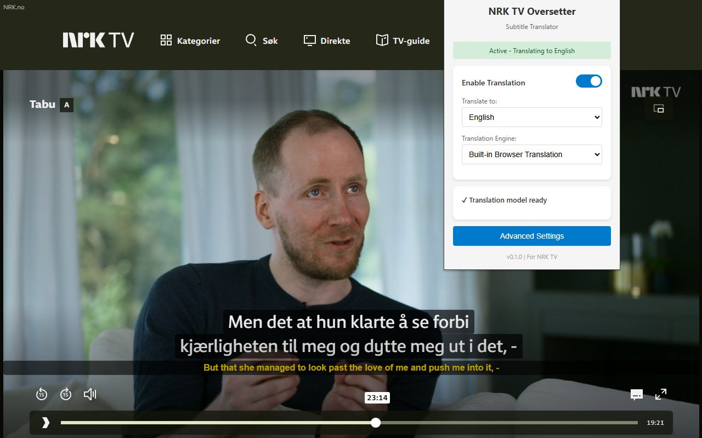
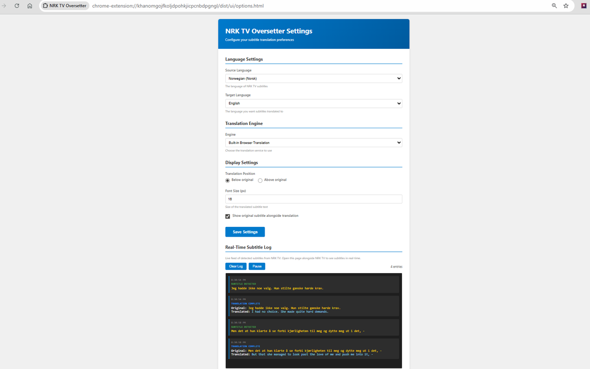

# NRK TV Oversetter

Translate Norwegian subtitles on [NRK TV](https://tv.nrk.no) in real-time, using the translation model built into your browser. Nothing you watch leaves your device.

[](https://chromewebstore.google.com/detail/nrk-tv-oversetter/hlnikafacjiekphhloakkbhokhfkpcem)
[](LICENSE)



## Install

| Browser | Status |
| --- | --- |
| **Chrome** | [Chrome Web Store](https://chromewebstore.google.com/detail/nrk-tv-oversetter/hlnikafacjiekphhloakkbhokhfkpcem) |
| **Edge** | Coming soon — Edge Add-ons submission pending |

## Browser support

Translation runs on the browser's built-in [Translator API](https://developer.chrome.com/docs/ai/translator-api), so support depends on your browser version:

| Browser | Minimum version | Languages available to the API |
| --- | --- | --- |
| Chrome | Stable | 44 |
| Microsoft Edge | **148+** | 145+ |

Edge shipped the Translator API to **stable in Edge 148**. Earlier Edge versions required Canary; that is no longer the case. If you are on Edge, update to 148 or later.

## Features

- Real-time translation of Norwegian subtitles as you watch
- **Every language your browser supports** — the list is read from the browser at runtime, so it is around 39 on Chrome and 145+ on Edge 148, rather than a fixed list that goes stale
- Optionally hide the Norwegian original and show only the translation
- Translation size that scales with NRK's own subtitles, so it stays in proportion in fullscreen and on small windows — or a fixed pixel size if you prefer
- Models download automatically, with live progress in the popup
- Works offline once the language model has downloaded
- **Caption history side panel**: every Norwegian line so far, with the translation hidden until you hover it. Hovering the panel pauses the video and leaving resumes it, and clicking a timestamp replays that line
- Works with NRK's own subtitles hidden or switched off: the captions are still captured
- Choose the mode from the popup, the settings page, or **NRK's own subtitle menu** (works in fullscreen)

> **Missing a language?** The list comes from your browser, so if something is absent your browser cannot translate into it yet. Edge 148+ supports considerably more than Chrome. [Open an issue](https://github.com/alcaann/nrk-tv-oversetter/issues/new/choose) if something looks wrong.



## Usage

1. Open [tv.nrk.no](https://tv.nrk.no) and start a video. The first time, a card on the player offers the two modes; picking one also starts the one-time model download
2. To change it later, pick a mode: **Dual subtitles** (translation under the Norwegian, on the video) or **Learning panel** (history on the side, translation on hover). From the extension icon, or in NRK's subtitle menu under *Oversetter*
3. If the model ever needs downloading again (e.g. after changing language), a **Download now** button appears in the panel or on the video

Settings: right-click the extension icon → **Options**.

## Roadmap

- [x] Populate the language list dynamically from the browser's Translator API (fixes missing languages such as Arabic)
- [x] Download progress, shown live in the popup
- [x] Model status readable without an open NRK tab
- [ ] Injector health check, to detect and report when NRK changes their page structure
- [ ] Edge Add-ons release

## Contributing

Contributions are welcome — this is a small project and pull requests are genuinely appreciated.

- **Found a bug, or missing a language?** [Open an issue](https://github.com/alcaann/nrk-tv-oversetter/issues/new/choose). Bug reports through the extension store are hard to reply to; GitHub issues let us actually talk it through.
- **Want to fix something?** Fork, branch, and open a pull request. See [CONTRIBUTING.md](CONTRIBUTING.md) for the build and test loop.
- **Subtitles stopped being detected?** NRK changes their site occasionally. That's usually a one-line selector fix — see [docs/CAPTION_DETECTOR.md](docs/CAPTION_DETECTOR.md).

## Store listings

Copy for both store listings lives in [store/](store/), kept in the repo so it stays
in step with the code. Update it whenever the supported languages, download
behaviour, or browser requirements change.

## Development

```bash
npm install
npm run build
```

Then load the unpacked extension: `chrome://extensions` (or `edge://extensions`) → enable **Developer mode** → **Load unpacked** → select the repo root.

**Commands:**

| Command | Purpose |
| --- | --- |
| `npm run build` | Full build (TypeScript + assets + bundling) |
| `npm run watch` | TypeScript in watch mode |
| `npm run clean` | Remove `dist/` |
| `npm run copy-assets` | Copy HTML/CSS into `dist/` |
| `npm run bundle-content` | Bundle the content script |

**Architecture** ([full docs](docs/ARCHITECTURE.md)):

| Path | Responsibility |
| --- | --- |
| [src/content/captions/](src/content/captions/) | Caption capture from NRK's subtitle track |
| [src/content/translation/](src/content/translation/) | Translation queue (ahead of the playhead) |
| [src/content/ui/](src/content/ui/) | History side panel and on-video translation |
| [tools/harness/](tools/harness/) | Real-Chrome test harness against tv.nrk.no |
| [src/core/translation/](src/core/translation/) | Translation engines (factory pattern) |
| [src/core/interfaces/](src/core/interfaces/) | Interfaces for extensibility |
| [src/ui/](src/ui/) | Popup and options pages |

**Adding a translation engine:** implement [ITranslationEngine](src/core/interfaces/ITranslationEngine.ts) and register it in [TranslationEngineFactory.ts](src/core/translation/TranslationEngineFactory.ts). There is no engine selector in the UI while there is only one engine.

## How it works

NRK's player loads subtitles into a native `TextTrack` on the video and paints the active cue itself. The extension reads that track directly, so it gets exact timings and lines ahead of time, and keeps working with NRK's subtitles hidden or switched off. Captions are translated ahead of the playhead with the browser's built-in Translator API, entirely on-device, and shown in a history side panel and (optionally) on the video.

See [docs/CAPTION_DETECTOR.md](docs/CAPTION_DETECTOR.md) for detection details.

## Troubleshooting

**No translations appearing?**
- On Edge, confirm you are on version 148 or later (`edge://settings/help`)
- Download the translation model from the popup first
- Refresh the NRK TV page after enabling the extension

**"Could not load the model" on Edge?**
- On Edge 148 for Linux we have seen the built-in translator fail for every language pair (`NotSupportedError: Unable to create translator`), including pairs unrelated to Norwegian, so it is not something the extension can fix
- Check with Microsoft's [Translator API playground](https://microsoftedge.github.io/Demos/built-in-ai/playgrounds/translator-api/): if that fails too, use Chrome

**Model download stuck or failing?**
- Restart the browser and try again — this is a known quirk of the built-in model download
- Check the browser console (F12) for errors

**Subtitles not being detected?**
- NRK may have changed their HTML structure
- [Open an issue](https://github.com/alcaann/nrk-tv-oversetter/issues/new/choose) — include the video you were watching
- The panel footer shows which caption source is active; see [docs/CAPTION_DETECTOR.md](docs/CAPTION_DETECTOR.md) and run `npm run harness:scenarios`

## Privacy

Subtitles are translated on your device by the browser's built-in model. No subtitle text, browsing history, or personal data is transmitted anywhere. See [PRIVACY.md](PRIVACY.md).

## License

[MIT](LICENSE)
