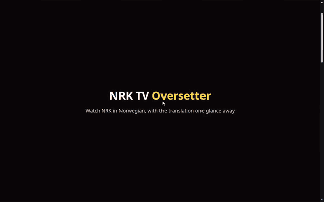
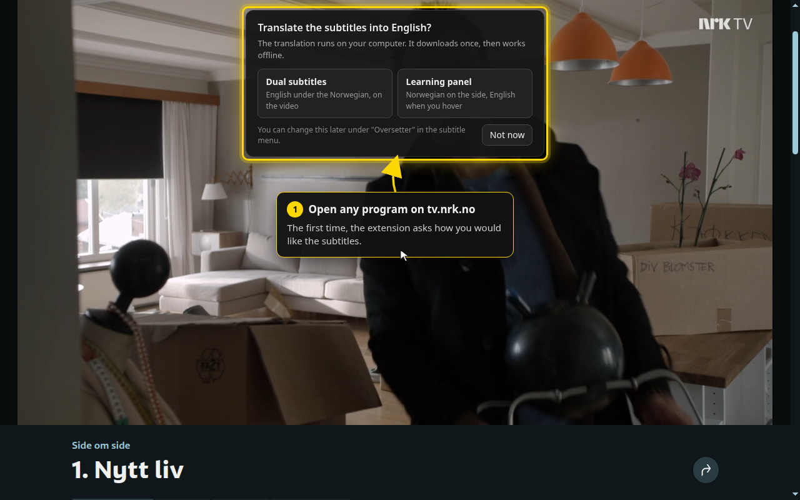
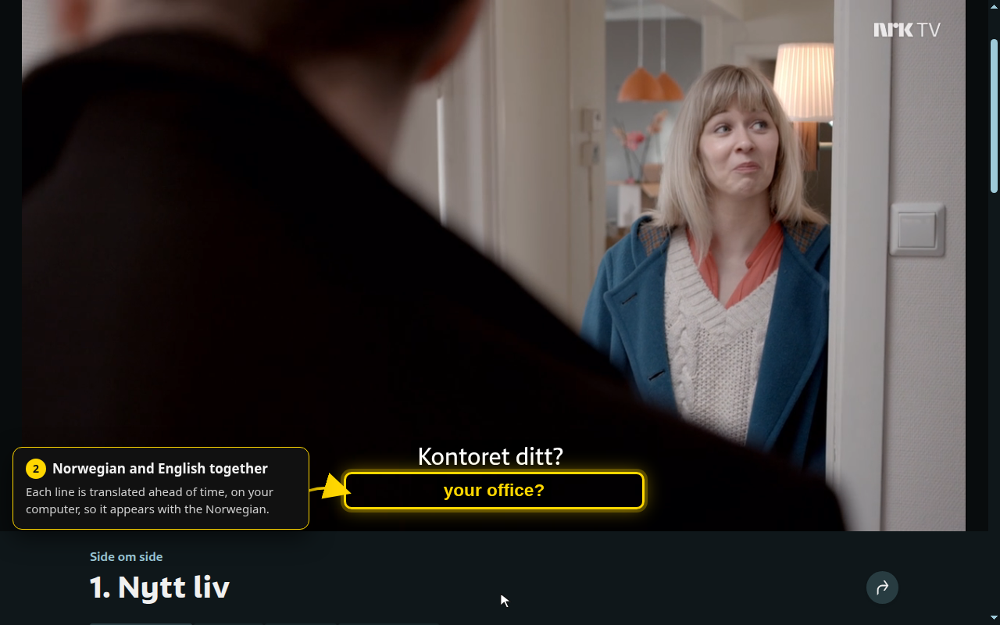
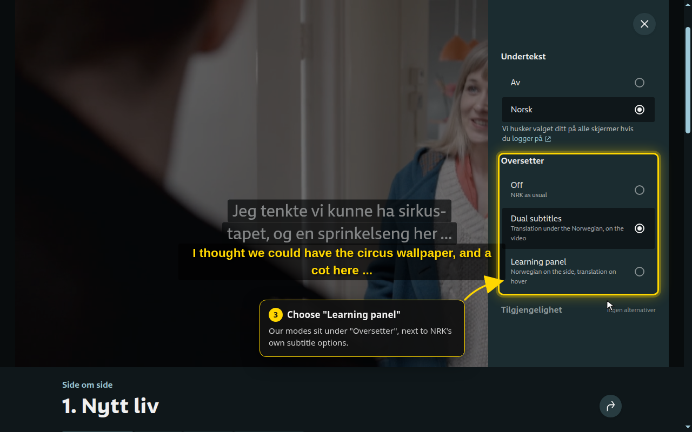
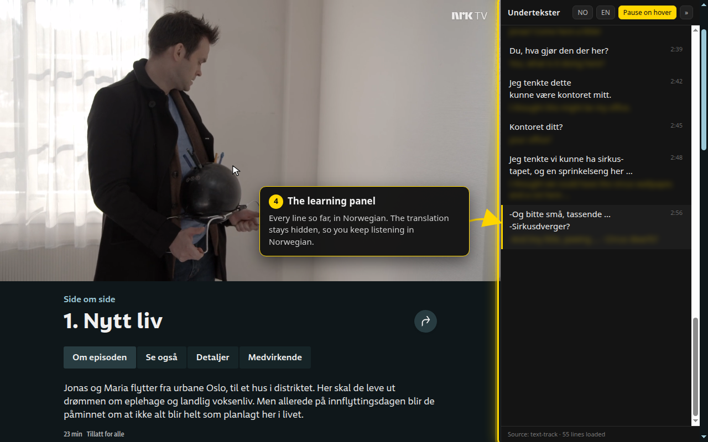
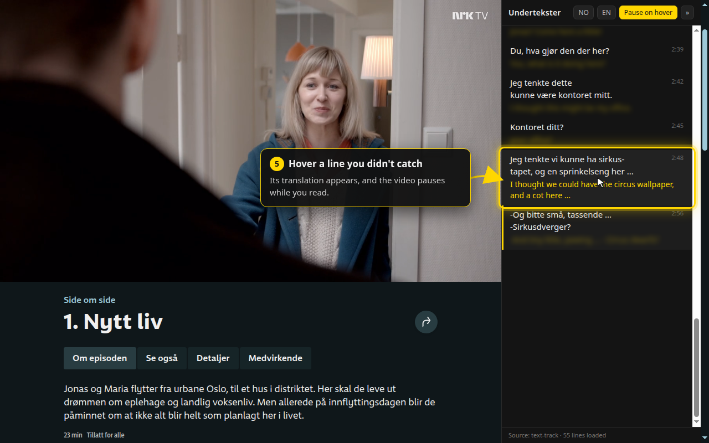
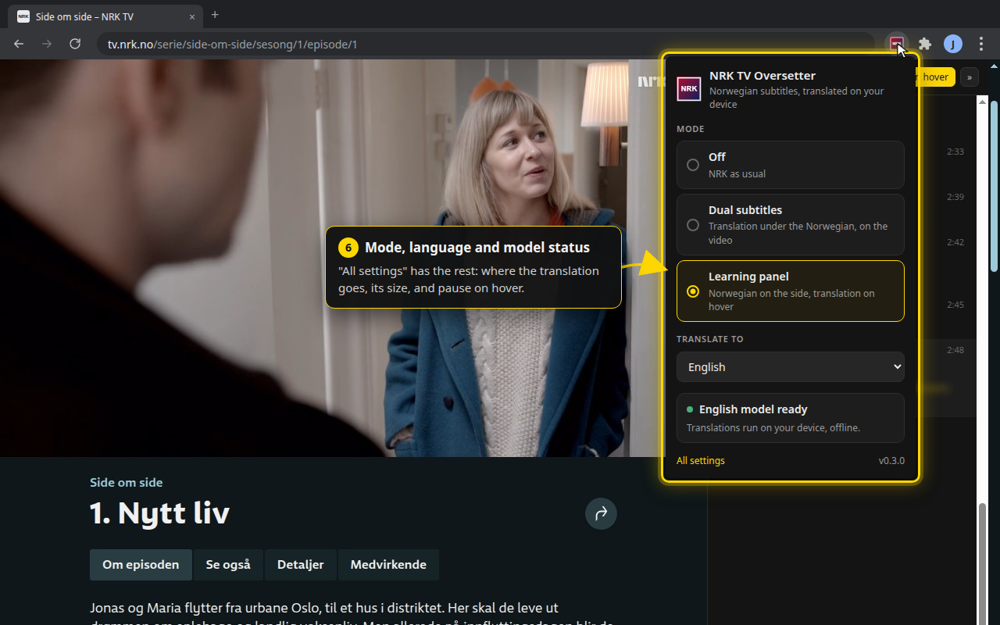

# NRK TV Oversetter

Watch [NRK TV](https://tv.nrk.no) in Norwegian, with the translation one glance away. Translation runs on your own computer, using the model built into your browser: nothing you watch leaves your device.

[](https://chromewebstore.google.com/detail/nrk-tv-oversetter/hlnikafacjiekphhloakkbhokhfkpcem)
[](LICENSE)



*One-minute walkthrough. [Full-quality video (MP4)](docs/tutorial/tutorial.mp4)*

## Two ways to watch

| | |
| --- | --- |
| **Dual subtitles**<br>The translation sits under NRK's Norwegian subtitle, on the video. Good for following along, and it works in fullscreen. | **Learning panel**<br>Every Norwegian line so far, in a panel beside the video. The translation stays hidden until you hover a line, and the video pauses while you read. |

## Install

Get it from the [Chrome Web Store](https://chromewebstore.google.com/detail/nrk-tv-oversetter/hlnikafacjiekphhloakkbhokhfkpcem). It is free, with no account and no API key.

## Getting started

### 1. Open any program on tv.nrk.no

The first time, a card on the player asks how you would like the subtitles. Until you choose, NRK stays exactly as it was.



### 2. Pick a mode

Choosing one also downloads the translation model, once (it then works offline). With **Dual subtitles**, the translation appears under the Norwegian. Each line is translated ahead of time, so it shows up together with the Norwegian.



### 3. Change mode at any time from NRK's subtitle menu

Our options sit under **Oversetter**, next to NRK's own subtitle choices, so this works in fullscreen too.



### 4. The learning panel

Every line so far, in Norwegian. NRK's own subtitles are hidden from the video, but the lines keep arriving in the panel. The **NO** and **EN** buttons put either back on the video.



### 5. Hover a line you did not catch

Its translation appears, and the video pauses while you read. Move the pointer away and it plays on. Click a line's time to hear it again.



### 6. Settings

The toolbar icon has the mode, the translation language and the model status. **All settings** has the rest: where the translation goes, its size, and pause on hover.



## Features

- **Two modes**: dual subtitles on the video, or the learning panel with hover-to-reveal and automatic pause
- **Choose the mode where you watch**: in NRK's own subtitle menu (fullscreen included), the toolbar popup, or the settings page
- **Ready when the line is spoken**: subtitles are read from NRK's subtitle track ahead of time, and translated before they appear
- **Works with NRK's subtitles hidden or switched off**: the extension still receives every line
- **Every language your browser can translate into**, read from the browser itself (around 40 in Chrome)
- **Private and offline**: translation runs on your device; after the one-time model download it needs no connection
- Translation size that follows NRK's own subtitle size, in fullscreen and small windows, or a fixed size
- Replay a line from the panel by clicking its time

## Browser support

Translation uses the browser's built-in [Translator API](https://developer.chrome.com/docs/ai/translator-api).

| Browser | Status |
| --- | --- |
| **Google Chrome** (desktop) | ✅ Works |
| **Microsoft Edge** on Linux | ❌ Edge's built-in translator does not work on Linux at the moment: it downloads the wrong language packs, and its translation service crashes. Reported to Microsoft as [MSEdgeExplainers#1424](https://github.com/MicrosoftEdge/MSEdgeExplainers/issues/1424). Use Chrome. |
| **Microsoft Edge** on Windows / macOS | Not yet tested. Edge 148 or later is required. |

## Troubleshooting

**No translation appears**
- If the panel or the video shows **Download now**, click it: the browser only downloads a model after a click on the page
- Reload the NRK tab after installing or updating the extension

**"The browser could not load the model"**
- On Edge for Linux, this is the Edge bug above. Microsoft's own [Translator API playground](https://microsoftedge.github.io/Demos/built-in-ai/playgrounds/translator-api/) fails in the same way. Use Chrome
- Elsewhere, click **Retry**. If it keeps failing, restart the browser

**A download is stuck**
- After 90 seconds without progress the extension gives up and offers **Retry**. Restarting the browser usually helps

**The panel is empty, or lines stop appearing**
- NRK may have changed their player. [Open an issue](https://github.com/alcaann/nrk-tv-oversetter/issues/new/choose) with a link to the program. The panel's footer shows which caption source is in use, which helps

**Missing a language?** The list comes from your browser: if a language is not there, your browser cannot translate into it yet. [Open an issue](https://github.com/alcaann/nrk-tv-oversetter/issues/new/choose) if something looks wrong.

## Privacy

Subtitles are translated on your device by the browser's built-in model. No subtitle text, browsing history or personal data is transmitted anywhere. See [PRIVACY.md](PRIVACY.md).

This extension is not affiliated with NRK.

## How it works

NRK's player loads the subtitles into a native `TextTrack` on the video and draws the active line itself. The extension reads that track directly, so it has exact timings and the upcoming lines, whatever NRK shows on screen. Lines are translated ahead of the playhead with the browser's Translator API, and drawn on the video, in the panel, or both.

More in [docs/ARCHITECTURE.md](docs/ARCHITECTURE.md) and [docs/CAPTION_DETECTOR.md](docs/CAPTION_DETECTOR.md).

## Development

```bash
npm install
npm run build
```

Load the unpacked extension: `chrome://extensions` → enable **Developer mode** → **Load unpacked** → select the repo root.

| Command | Purpose |
| --- | --- |
| `npm run build` | TypeScript, assets and the content-script bundle |
| `npm run watch` | TypeScript in watch mode |
| `npm run package` | Clean build, zipped for the store into `release/` |
| `npm run harness:scenarios` | Drive real Chrome with the extension on live tv.nrk.no and check it against NRK's subtitle track ([tools/harness/](tools/harness/README.md)) |
| `node tools/media/record-tutorial.cjs` | Re-record the walkthrough video, GIF and screenshots in `docs/tutorial/` |
| `node tools/media/render-store-assets.cjs` | Render the store promo tiles in `store/assets/` |

| Path | Responsibility |
| --- | --- |
| [src/content/captions/](src/content/captions/) | Reading NRK's subtitle track (with a page fallback) |
| [src/content/translation/](src/content/translation/) | Translating ahead of the playhead; model download status |
| [src/content/ui/](src/content/ui/) | Learning panel, on-video translation, NRK menu section, first-run card |
| [src/core/](src/core/) | Settings, modes, languages, the translation engine |
| [src/ui/](src/ui/) | Popup and settings page |

Store listing copy and images live in [store/](store/), so they stay in step with the code. Changes are listed in [CHANGELOG.md](CHANGELOG.md).

## Contributing

Contributions are welcome. This is a small project, and pull requests are appreciated.

- **Found a bug, or missing a language?** [Open an issue](https://github.com/alcaann/nrk-tv-oversetter/issues/new/choose). Store reviews are hard to reply to; GitHub issues let us talk it through.
- **Want to fix something?** See [CONTRIBUTING.md](CONTRIBUTING.md) for the build and test loop.

## Roadmap

- [x] Language list read from the browser
- [x] Learning panel with hover-to-reveal and pause on hover
- [x] Modes in NRK's own subtitle menu
- [x] First-run setup on the player
- [ ] Edge Add-ons release, once Edge's translator works ([MSEdgeExplainers#1424](https://github.com/MicrosoftEdge/MSEdgeExplainers/issues/1424))

## License

[MIT](LICENSE)
